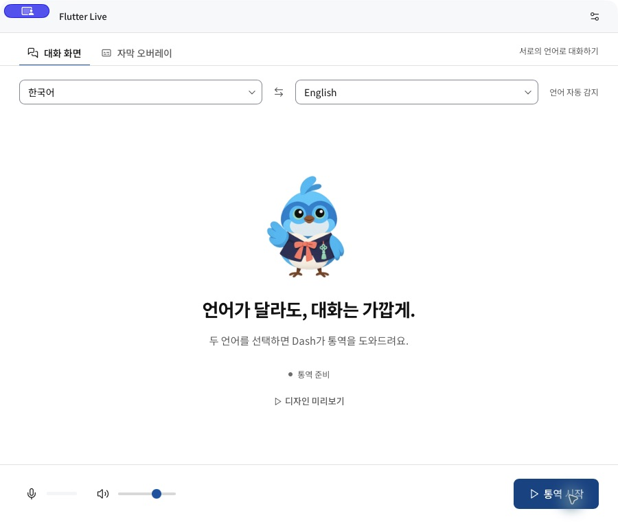

# Flutter Live — Flutter Seoul

**Tauri 2 + Svelte 5**로 새로 만든 macOS Gemini Live 통역 앱입니다. Flutter 행사용 이름과 Dash 캐릭터를 사용하지만 Flutter SDK에 의존하지 않습니다. 기존 Flutter 앱 코드는 제거했습니다.

지원 언어는 한국어·영어·일본어·중국어입니다. 두 선택 목록에 네 언어가 항상 표시되며 같은 언어를 고르면 양쪽이 교환됩니다.

대화 모드는 두 언어 사이에서 발화 언어를 감지하고 반대 언어로 통역하도록 지시합니다. 프레젠테이션용 자막 오버레이는 원문 언어와 번역 언어를 직접 지정해 한 방향으로 통역합니다. 대화 화면과 독립 자막 오버레이를 제공하며, 현재 원문·번역만 표시하고 대화 기록은 저장하지 않습니다.



## 개발 실행

macOS 13 이상, 전체 Xcode, Node.js 22.12 이상, Rust stable이 필요합니다.

```sh
# 내부 Atlas Design Pack에 대한 SSH 접근 권한 필요
node scripts/prepare-design-pack.mjs
npm ci
npm run tauri -- dev
```

웹 화면만 확인하려면 `npm run dev`를 사용합니다. 마이크·시스템 오디오·메뉴바·독립 오버레이는 macOS 앱에서만 동작합니다.

이 버전은 내부 디자인 패키지 `@imfacto/svelte`의 **Linear** 스타일을 직접 사용합니다. 패키지는 `UNLICENSED`이며 공개 저장소에 포함하지 않습니다. 내부 패키지 접근 권한이 없는 환경에서는 소스 빌드가 불가능합니다. v0.2.2 및 후속 수정 v0.2.3 앱 번들의 공개 배포는 패키지 권리자의 승인을 받았으며, 패키지 자체의 라이선스가 변경된 것은 아닙니다. [출처 및 준비 방법](vendor/README.md)을 참고하세요.

## 사용

1. 설정 → 모델 연결에서 API 키를 입력합니다. 모델은 앱에서 모드별로 고정하며, 현재 대화·자막 오버레이 모두 `gemini-3.8-live`를 사용합니다. [공식 모델 안내](https://ai.google.dev/gemini-api/docs/models/gemini-3.8-live)
2. 오디오 · 대쉬에서 입력 소스와 마이크를 선택합니다. **자동**은 macOS 기본 입력을 따릅니다. 연결 목록은 Core Audio에서 갱신합니다.
3. 대화 모드에서는 두 언어를, 자막 오버레이에서는 원문·번역 언어를 선택하고 통역을 시작합니다. 통역 중 모드를 바꾸면 기존 연결이 종료되므로 다시 시작해야 합니다. 자막 오버레이 모드에서는 번역 음성이 기본으로 꺼지지만 번역 자막은 계속 표시합니다. **통역 시작 → 자막 띄우고 창 숨기기** 순서로 사용하세요. 통역을 시작하기 전에는 창 숨기기 버튼이 비활성화됩니다.
4. 설정 적용은 연결을 시작하지 않습니다. API 키는 이번 실행의 메모리에만 보관하며 앱 종료 시 사라집니다.

**디자인 미리보기**는 녹음·API 호출 없이 예시 자막과 세 의상·여덟 동작을 확인합니다. **마이크 테스트**도 서버 전송 없이 로컬 입력만 확인합니다. 앱 창을 닫아도 메뉴바에서 계속 실행되며 메뉴바의 종료로 앱을 끝냅니다.

## 화면 · 자막 설정

설정 → **화면 · 자막**에서 밝게·어둡게·시스템 테마, Linear 기본·macOS 시스템·명조 글꼴, 화면 글자 크기(90–130%), 번역 자막 크기(18–48px)를 조절합니다. 자막 배경은 밝게·어둡게·화면 테마와 같게 중 선택합니다.

변경은 즉시 미리 보이며 **설정 적용**을 누르면 다음 실행에도 유지됩니다. 취소하면 이전 표시 설정으로 돌아갑니다. 표시 설정만 로컬에 저장하며 API 키와 발화 내용은 저장하지 않습니다. 큰 자막에는 독립 자막 창 높이도 맞춰집니다.

## 구성

- `src/`: Svelte 화면, 현재 자막, 세션 상태, Gemini WSS, bounded reconnect queue.
- `src-tauri/`: Rust 메뉴바·창 관리와 Swift 오디오 호스트 연결.
- `src-tauri/native/AudioHost.swift`: Core Audio 입력 장치, AVAudioEngine 캡처·재생, ScreenCaptureKit.
- `public/dash/`: 기존에 제작한 2D Dash 투명 애니메이션. 한복·갓·단청, 8개 클립, 12fps.
- `art/`: 편집 가능한 캐릭터 제작 원본. 앱 실행에는 Blender가 필요하지 않습니다.

v0.2.3에서는 자막을 실제 비활성 NSPanel에 표시해 Chrome의 Google Slides 발표 전체화면 위에 올립니다. v0.2.2의 일반 창 설정만으로 표시되지 않던 문제를 수정했습니다. [전체화면 동작과 검증 범위](docs/fullscreen-overlay.md)를 참고하세요.

발표 모드는 발화가 재개되어도 생성 중인 번역을 중단하지 않습니다. 연결·재연결·오류 상태는 독립 자막 창에도 표시합니다. macOS 14 이상에서는 숨겨진 메인 웹뷰의 백그라운드 정지를 비활성화합니다. macOS 13에서는 이 설정을 지원하지 않으므로 발표 중 메인 창을 보이는 상태로 유지하세요.

무음에는 연결을 유지하며, 일시적인 통신 오류는 사용자가 중지할 때까지 자동 재시도합니다. 첫 재시도 대기는 250–500ms이고, 연결 성공까지의 시간이나 통역 지연을 보장하는 수치는 아닙니다. [무음 대기·자동 복구와 한계](docs/live-recovery.md)를 참고하세요.

입력은 16kHz PCM16 mono 20ms(640바이트), 출력은 24kHz PCM16 mono입니다. 재연결 입력은 최대 2초, 네이티브 예약 재생도 최대 2초로 제한합니다. 서버 인터럽트는 예약 재생을 즉시 비웁니다. 스피커 에코 제거, 음성 복제, 무지연 통역을 보장하지 않습니다.

## 빌드와 검증

```sh
npm run check
npm test
npm run tauri -- build --debug
```

앱 위치: `src-tauri/target/debug/bundle/macos/Flutter Live.app`

[제품 기획서](docs/product-plan.md), [현재 검증 범위](docs/implementation-status.md), [디자인 기준](DESIGN.md)을 참고하세요. 실제 Gemini 통역은 사용자 키로 별도 검증해야 합니다. 이 버전은 서명·공증된 배포본이 아닙니다.

## 라이선스

이 프로젝트의 원본 코드는 [MIT](LICENSE)입니다. 내부 디자인 패키지와 제삼자 캐릭터·상표에는 MIT를 적용하지 않습니다. [Third-party notices](THIRD_PARTY_NOTICES.md)를 참고하세요. Google의 공식 제품이 아닙니다.
