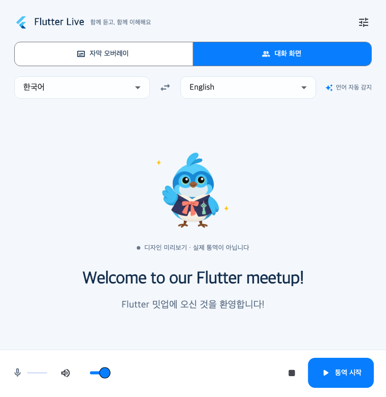
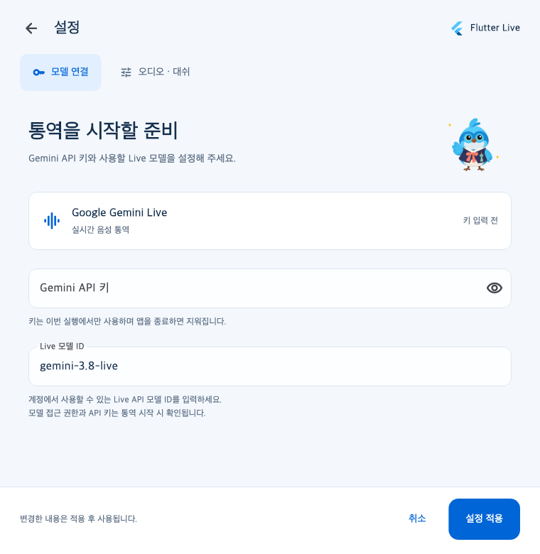

# Flutter Live — Flutter Seoul

macOS 발표용 자막 오버레이와 양방향 대화 화면을 제공하는 Flutter 통역 앱입니다. 두 언어를 지정하면 Gemini Live에 반대 언어로 통역하도록 지시합니다. 현재 발화만 표시하고 대화 기록은 저장하지 않습니다.



## 실행

macOS 13 이상, Flutter 3.47.9 / Dart 3.13.7, 전체 Xcode가 필요합니다.

```sh
flutter pub get
flutter run -d macos
```

빌드된 앱: `build/macos/Build/Products/Debug/Flutter Live.app`.

API 없이 **디자인 미리보기**로 두 화면과 Dash 동작을 확인할 수 있습니다. 실제 통역은 설정에서 자신의 Gemini API 키와 접근 가능한 Live 모델을 입력한 후 시작합니다. 키는 실행 중 메모리에만 보관합니다. 모델 이름은 변경할 수 있습니다. 마이크·시스템 오디오 접근 권한은 macOS에서 승인해야 합니다.

## 모델 설정

오른쪽 위 설정 버튼을 누르면 **모델 연결** 페이지가 열립니다. Gemini API 키를 붙여넣고 계정에서 사용할 수 있는 Live 모델 ID를 입력한 뒤 **설정 적용**을 누르세요. 키는 기본적으로 가려지며 눈 아이콘으로 표시·숨김을 전환합니다. 적용 전에 취소하거나 뒤로 가면 기존 값이 유지됩니다.

키는 이번 앱 실행 중에만 보관합니다. 설정 적용은 연결 검증이나 통역 시작을 수행하지 않습니다. 키와 모델 접근 권한은 통역을 시작할 때 확인됩니다. API 키가 없는 상태에서 통역 시작을 누르면 이 페이지로 이동합니다. 통역 중이거나 일시정지한 세션에서는 연결 설정이 잠기며, 통역을 종료해야 변경할 수 있습니다.

**오디오 · 대쉬** 탭에서 연결된 마이크(블루투스·USB·유선 등), 시스템 오디오, 의상, 확성기 감도를 선택합니다. **자동**은 macOS 기본 입력을 따르며, 장치 연결·해제 시 목록을 갱신합니다. **마이크 테스트**는 API 키 없이 입력 레벨만 확인하며 저장하거나 서버로 보내지 않습니다.



## 구현

- Flutter: 두 언어·모드 선택, 현재 원문/번역, WSS, 자동 재연결, 입력/출력 PCM 순환 버퍼.
- Swift: 메뉴바, 독립 NSPanel 자막, AVAudioEngine, ScreenCaptureKit, 16 kHz PCM16 mono 20 ms 입력, 24 kHz 출력.
- 인터럽트: Flutter 큐와 네이티브 예약 재생을 세대 번호와 함께 폐기.
- Dash: Blender 2D 컷아웃 리그(20개 본·8개 동작)와 한복·갓·단청 3가지 의상. 앱과 네이티브 오버레이는 12 fps 투명 아틀라스를 사용하며 설정에서 의상을 바꿀 수 있습니다.

현재 버전은 얼굴·의상·소품을 하나의 완성형 일러스트로 다시 그린 **2D Dash**입니다. 본·키프레임·텍스처를 포함한 Blender 원본을 제공하고 앱은 렌더된 프레임을 재생합니다. 한복·갓은 선글라스를 벗고, 단청은 선글라스를 유지합니다. 갓 아래 정수리 깃은 숨깁니다. 공개 저장소에는 현재 사용하는 2D 원본과 실행용 에셋을 포함합니다.

## 산출물

- [제품 기획서](docs/product-plan.md), [개발·검증 현황](docs/implementation-status.md)
- [2D Blender 원본](art/dash_2d/illustrated/dash_2d.blend), [제작·재현 방법](art/dash_2d/README.md)
- [2D 동작 미리보기](art/dash_2d/illustrated/renders/motion-preview.webp), [3가지 의상·8개 동작](art/dash_2d/illustrated/renders/contact-sheet.jpg)

## 검증

```sh
flutter analyze
flutter test
flutter build macos --debug
# macOS 전용 스크린샷 재생성
flutter test test/ui_snapshot_test.dart --dart-define=CAPTURE_UI=true --update-goldens
```

분석, 20개 자동 테스트(선택적 화면 캡처 1개 제외), macOS Debug 빌드를 통과했습니다. 실제 macOS 앱에서 Bluetooth 이어폰의 재연결 목록 갱신과 PCM 입력 레벨을 확인했습니다. USB·유선 장치, 실제 Gemini 통역, 시스템 캡처 품질, 지연·에코, 행사장 장시간 운영은 아직 검증하지 않았습니다. 음성 복제나 무지연 동시통역은 보장하지 않습니다.

## 라이선스와 프로젝트 성격

앱 코드와 이 프로젝트의 기여분은 [MIT License](LICENSE)를 따릅니다. Flutter·Dart·Dash·Gemini 관련 이름과 표장은 각 권리자의 자산이며, 이 프로젝트는 Google의 공식 제품이나 후원 프로젝트가 아닙니다. 캐릭터 에셋의 출처와 범위는 [THIRD_PARTY_NOTICES.md](THIRD_PARTY_NOTICES.md)를 참고하세요.

현재는 개발용 PoC이며 서명·공증된 설치 파일이나 App Store 배포본은 제공하지 않습니다. 실제 통역을 시작하면 선택한 오디오가 사용자의 API 키를 통해 Google Gemini API로 전송되며 해당 API 이용 요금과 정책이 적용됩니다.
